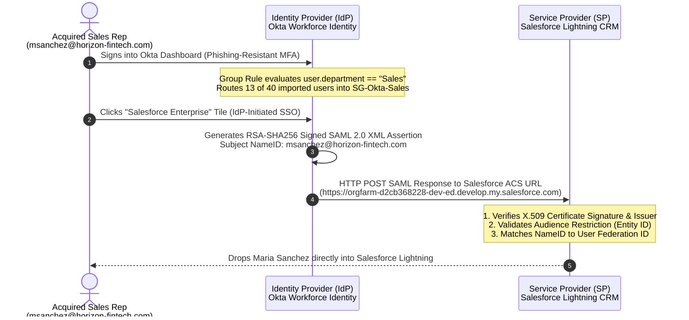
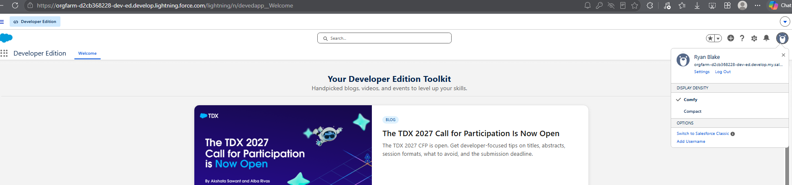
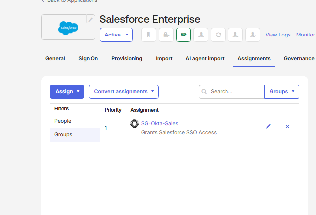
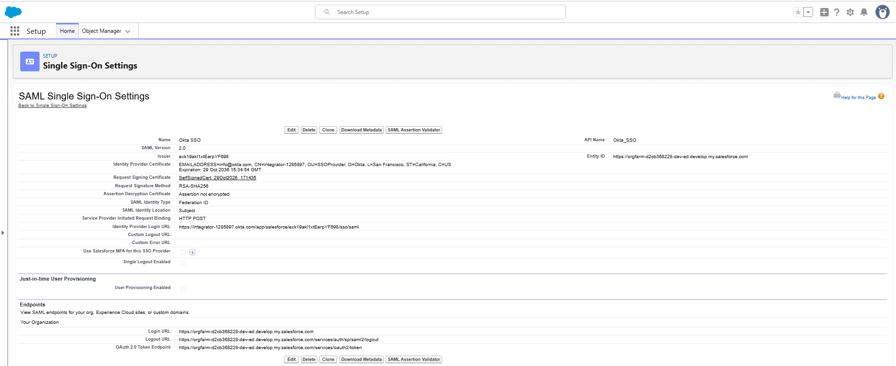
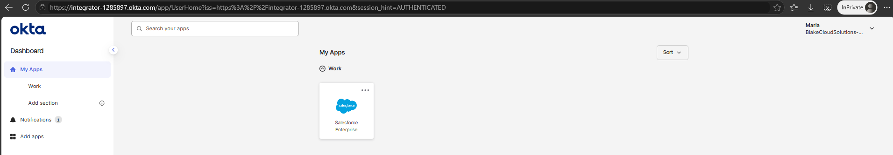
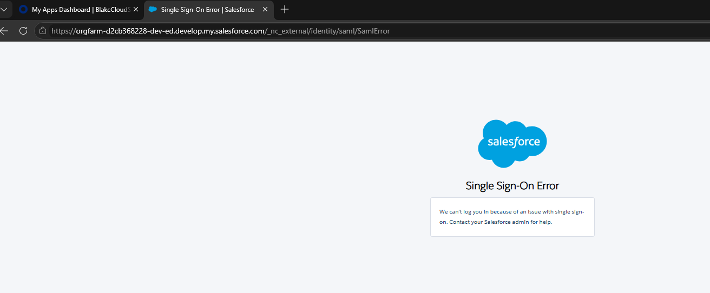
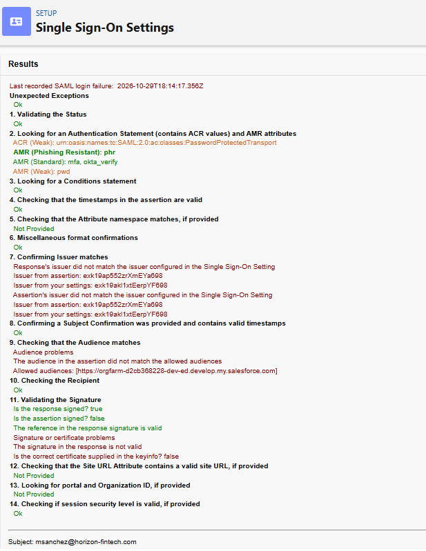
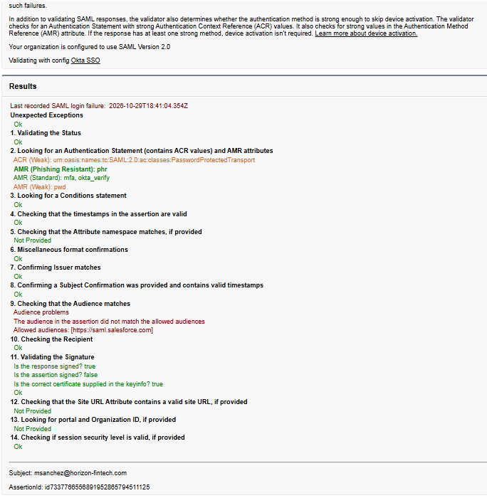
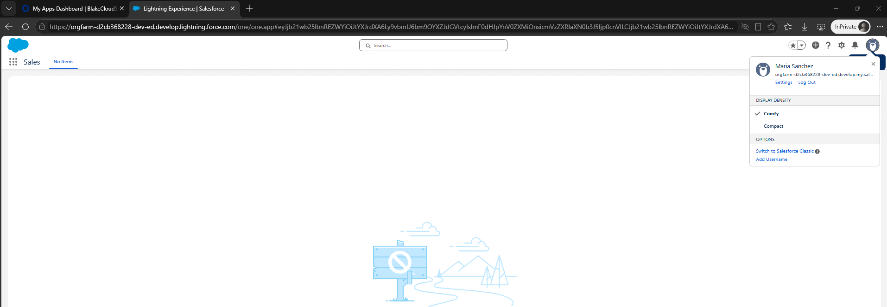

# Okta to Salesforce SAML 2.0 SSO: Solving the Day-1 M&A Identity Problem

## The Business Problem
If you have ever seen what happens to IT during a company merger or acquisition (M&A), you know Day 1 is usually chaos. 

Imagine **Capital One** acquires a fast-growing fintech company called **Horizon Fintech** with **40 employees** spread across Sales, IT, Finance, HR, Engineering, and Marketing. Leadership needs Horizon's **13 Sales reps** logging into the parent company's **Salesforce CRM** immediately so they don't lose momentum on active deals. 

Here is the headache for the IAM team:
1. **Conflicting Domains:** The acquired employees still sign into Okta using their legacy `@horizon-fintech.com` emails, while the Salesforce admins provisioned their target CRM accounts under `@capitalone-acquisitions.com`. Standard username-to-username SSO will fail right out of the gate.
2. **License Waste & Ticket Bottlenecks:** Out of the 40 acquired employees, only the 13 Sales reps should get Salesforce seats. Manually sorting through a 40-person CSV or assigning app access ticket-by-ticket wastes time and risks giving expensive CRM licenses to Engineering or HR by mistake.
3. **Password Sprawl:** Handing out temporary Salesforce passwords defeats Zero Trust and guarantees a flood of password-reset tickets on Monday morning.

---

## How I Solved It
Instead of waiting months for Active Directory domains to merge or manually assigning app access, I built an automated SAML 2.0 federation pipeline between **Okta Workforce Identity** and **Salesforce Lightning**:

* **Automated Least-Privilege RBAC via Dynamic Group Rules:** After bulk-importing all 40 `@horizon-fintech.com` users across 6 departments via CSV, I built an Okta Group Rule that evaluates `user.department == "Sales"`. Okta automatically filtered the 40-user cohort and routed only the **13 Sales reps** into `SG-Okta-Sales`, which grants them the **Salesforce Enterprise** app tile while keeping the other 27 non-sales employees out.
* **Cross-Domain Federation (`Federation ID` Mapping):** To bridge the mismatched email domains, I configured Salesforce to ignore the standard Salesforce Username during SAML login and match against the user's **Federation ID** field instead. That lets `msanchez@horizon-fintech.com` authenticate straight into `msanchez@capitalone-acquisitions.com` without ever typing a Salesforce password.
* **Real-World SAML Debugging (The Best Part of the Lab):** My first live login test failed with a generic Salesforce error screen. Rather than guessing at settings, I used the **Salesforce SAML Assertion Validator** to inspect the raw XML payload and fix three classic enterprise blockers: a stale `Issuer` ID, an X.509 certificate mismatch, and a tricky `Audience Restriction` (`Entity ID`) bug where Okta's custom domain template was double-appending `.my.salesforce.com`.

---

## Architecture & SAML 2.0 Handshake

### Environment Specs
| Component | Configuration Detail |
| :--- | :--- |
| **Identity Provider (IdP)** | Okta Workforce Identity (`integrator-1285897.okta.com`) |
| **Service Provider (SP)** | Salesforce Developer Edition (`orgfarm-d2cb368228-dev-ed.develop.my.salesforce.com`) |
| **M&A User Dataset** | 40 Users across 6 Departments ([`data/horizon_fintech_users.csv`](data/horizon_fintech_users.csv)) |
| **Protocol & Binding** | SAML 2.0 (`HTTP POST`) |
| **Signing Algorithm** | RSA-SHA256 with X.509 IdP Certificate |
| **Identity Mapping** | `Assertion contains the Federation ID from the User object` |
| **Access Control** | Okta Dynamic Group Rule (`user.department == "Sales"`) $\rightarrow$ `SG-Okta-Sales` (13 Users) |

---

## Step 1: Standing Up the Environment & Automating Access

### 1.1 Baseline Okta & Salesforce Tenants
I started with a clean Okta Workforce Identity tenant and a Salesforce Lightning Developer Edition environment with a custom My Domain configured.

*Figure 1: Initializing the Okta Admin Console.*

*Figure 2: Target Salesforce Developer Edition environment.*

### 1.2 Dynamic RBAC with `SG-Okta-Sales`
Once all 40 acquired employees were imported from [`data/horizon_fintech_users.csv`](data/horizon_fintech_users.csv) and the 13 Sales reps were automatically routed into `SG-Okta-Sales` by the department rule, I assigned the **Salesforce Enterprise** app directly to that security group. Now, whenever HR onboards a new Sales rep, Okta hands them Salesforce automatically without IT touching a ticket.

*Figure 3: Linking the Salesforce Enterprise SAML integration to `SG-Okta-Sales`.*

---

## Step 2: Wiring Up Cross-Domain SAML 2.0 in Salesforce

Inside Salesforce **Single Sign-On Settings**, I built the `Okta SSO` trust relationship. The key setting here is **SAML Identity Type**: instead of checking the Salesforce Username, it checks the **Federation ID** on the User object.

* **SAML Identity Type:** `Federation ID`
* **SAML Identity Location:** `Subject` (`<saml2:NameID>`)
* **Service Provider Initiated Request Binding:** `HTTP POST`
* **Entity ID:** `https://orgfarm-d2cb368228-dev-ed.develop.my.salesforce.com`

*Figure 4: Configuring SAML 2.0 in Salesforce with Federation ID lookup and custom Entity ID.*

---

## Step 3: When Things Break — Troubleshooting the SAML Handshake

Setting up SSO on paper is easy; fixing it when a user gets locked out is what actually matters on the job.

I opened an InPrivate browser window and logged into Okta as our test sales rep, **Maria Sanchez** (`msanchez@horizon-fintech.com`). Thanks to our dynamic group rule, the **Salesforce Enterprise** tile was waiting right on her dashboard.

*Figure 5: Maria Sanchez's Okta End-User Dashboard showing the dynamically assigned Salesforce app.*

When I clicked the tile, Salesforce immediately threw the dreaded **"Single Sign-On Error: We can't log you in because of an issue with single sign-on"** screen.

*Figure 6: Initial SAML handshake failure at `/_nc_external/identity/saml/SamlError`.*

### Root Cause #1: Stale App Instance Metadata (`Issuer` & X.509 Certificate)
Instead of guessing what went wrong, I jumped into my admin session and opened the **Salesforce SAML Assertion Validator**. It automatically caught the failed XML assertion and pointed straight to **Steps 7, 9, and 11**:

*Figure 7: SAML Assertion Validator flagging an Issuer mismatch (Step 7), Audience problem (Step 9), and invalid X.509 certificate signature (Step 11).*

* **What happened:** While configuring Okta earlier, I had recreated the Salesforce app instance. Okta spun up a new instance ID (`exk19ap552zrXmEYa698`) with a brand-new signing certificate, while Salesforce was still holding onto the `Issuer` (`exk19akl1xtEerpYF698`) and `.cert` file from the old tab.
* **The Fix:** I pulled the fresh `.cert` file, updated the `Issuer` ID (`exk19ap552zrXmEYa698`), and updated the IdP Login URL in Salesforce.

### Root Cause #2: The Okta Custom Domain "Double `.my`" Trap (Step 9)
I ran the test again. In the Validator, Steps 7 and 11 flipped to green `Ok`—proving the `Issuer` and cryptographic signature were now valid! However, **Step 9 (Checking that the Audience matches)** still failed:

*Figure 8: SAML Assertion Validator showing green checkmarks for Issuer and Signature, isolating the final failure to Step 9 (Audience).*

* **What happened:** In Okta's pre-built Salesforce OIN app, whatever you type into the **Custom Domain** field automatically gets `.my.salesforce.com` tacked onto the end when Okta builds the `<saml2:Audience>` tag. Because I originally entered `orgfarm-d2cb368228-dev-ed.develop.my`, Okta was sending `https://orgfarm-d2cb368228-dev-ed.develop.my.my.salesforce.com` (with a double `.my.my`), which didn't match `https://orgfarm-d2cb368228-dev-ed.develop.my.salesforce.com` or `https://saml.salesforce.com`.
* **The Fix:** I edited the Okta app's **Custom Domain** field to `orgfarm-d2cb368228-dev-ed.develop` (stripping the `.my` suffix), aligned Salesforce's **Entity ID** to `https://orgfarm-d2cb368228-dev-ed.develop.my.salesforce.com`, and added `msanchez@horizon-fintech.com` to Maria's **Federation ID** in Salesforce.

---

## Step 4: Working SSO in Production

With the `Issuer`, X.509 certificate, `Audience` (`Entity ID`), and `Federation ID` all lined up, I clicked the **Salesforce Enterprise** tile from Maria's Okta dashboard one more time. 

The SAML 2.0 POST assertion sailed through all 14 validation checks (including phishing-resistant MFA context `amr: phr, mfa, okta_verify`) and logged Maria straight into her Salesforce Lightning workspace without ever asking for a Salesforce password.

*Figure 9: End-to-end SAML 2.0 success—Maria Sanchez logged into Salesforce Lightning alongside her Okta My Apps portal.*

---

## License
Distributed under the MIT License. See [`LICENSE`](LICENSE) for full details.
